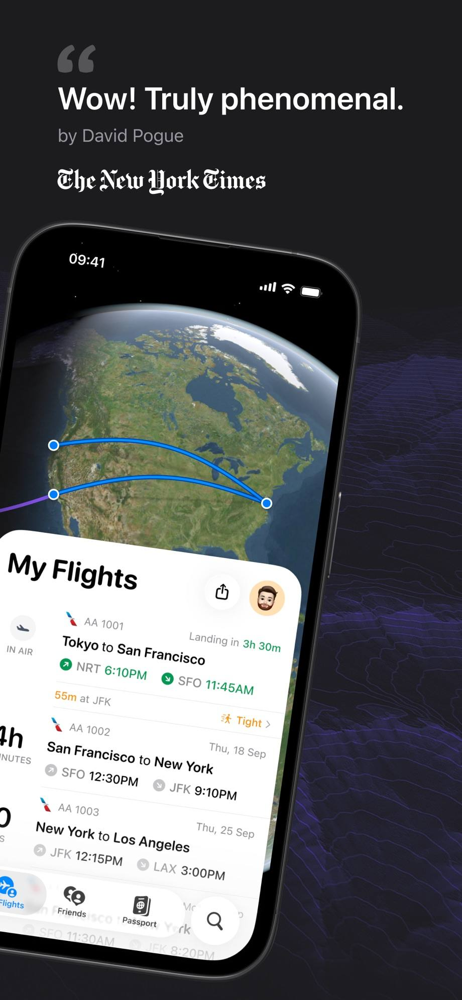
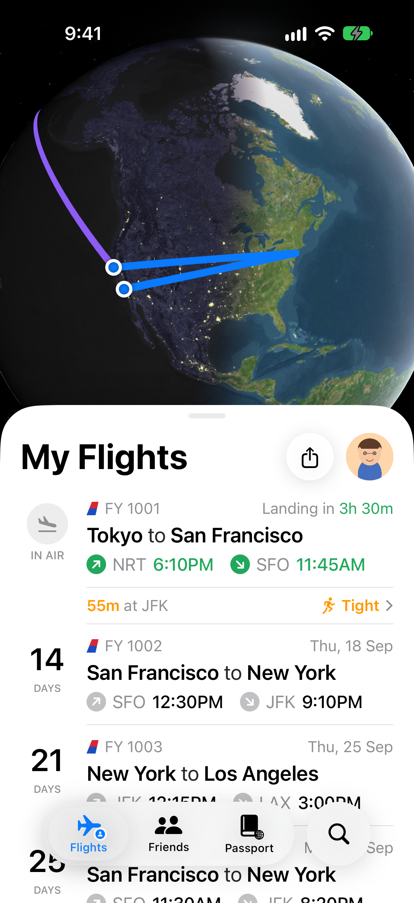
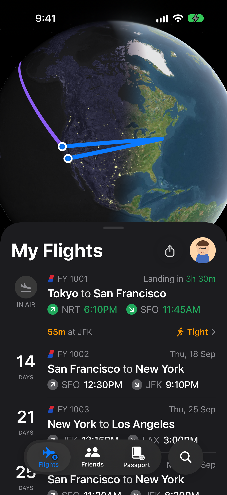

# 模仿 Flighty：把一顆地球和一張卡片疊在一起

> 彼得潘的 iOS App 程式設計 #03・模仿 App Store 上架的 App，製作一頁精美的 App 畫面

| 原版 Flighty | 我的版本 |
|---|---|
|  |  |

## 為什麼是 Flighty

這次的作業要模仿一個 App Store 上架的 App。最常被拿來仿的大概是 Instagram、Spotify、Netflix，我想挑一個比較少人做、但畫面一看就很「高級」的。

最後選了 **Flighty**。它是一個追蹤航班的 App，拿過 2023 年的 Apple 設計大獎。打開它的「My Flights」，上面是一顆衛星地球，航線用藍色的弧線畫在上面；下面浮著一張白色圓角卡片，列出接下來的每一班飛機。

它看起來很簡單，可是每一個細節都有講究：哪些字加粗、哪些字是灰色、準點是什麼綠、轉機太趕是什麼橘。要做得像，就得一個一個拆開來看。

## 先拆解畫面

我先把原版截圖放大，把畫面拆成三層：

1. **最底下**：衛星地球和航線
2. **中間**：可以往上捲的白色卡片
3. **最上面**：浮在畫面上的半透明 Tab Bar

這三層剛好就是一個 `ZStack`：

```swift
ZStack(alignment: .bottom) {
    GlobeMapView(flights: flights)
        .frame(height: 520)
        .frame(maxHeight: .infinity, alignment: .top)
        .ignoresSafeArea(edges: .top)

    ScrollView {
        VStack(spacing: 0) {
            Color.clear.frame(height: 330)   // 讓地球露出來
            MyFlightsSheet(flights: flights)
        }
    }

    FloatingTabBar()
}
```

卡片放在 `ScrollView` 裡，上面墊一塊透明的空間。往上捲的時候，卡片會蓋過地球，就像原版一樣。

## 一顆真的地球

原版上方的地球是衛星圖。我一開始以為要找一張地球的圖片，後來發現 MapKit 就做得到：用衛星圖模式，把攝影機拉到 2,600 萬公尺高，地圖就會變成一顆 3D 地球。

```swift
Map(initialPosition: .camera(MapCamera(
        centerCoordinate: CLLocationCoordinate2D(latitude: 38, longitude: -175),
        distance: 26_000_000, heading: 0, pitch: 0))) {
    MapPolyline(coordinates: arc(from: from, to: to))
        .stroke(Theme.route, lineWidth: 4)
}
.mapStyle(.imagery(elevation: .realistic))
```

航線一開始我用 `contourStyle: .geodesic` 畫真正的大圓航線，結果舊金山飛紐約幾乎是一條直線，跟原版那種往上拱的大弧線差很多。原來 Flighty 的弧線是刻意誇張過的。所以我自己算：把起點到終點切成 60 段，每一點的緯度再加上 `sin(π·t)` 乘一個高度，中間拱最高、兩端貼回機場，距離越遠拱得越高。

一開始我以為把 `distance` 調大就能看到整顆地球，結果從 1,400 萬改到 2,200 萬公尺，畫面一模一樣。原來 MapKit 會限制鏡頭最遠能拉到哪裡。後來我換個想法：既然鏡頭拉不遠，那就把地圖畫成 1.8 倍大，再用 `scaleEffect` 縮回來，同樣的高度就能看到更大一塊地球。線寬和機場圓點也跟著乘 1.8，縮回來後才會是正常粗細。改完再跑一次，北美、格陵蘭和旁邊的星空終於都進到畫面裡了。

```swift
GeometryReader { geo in
    map
        .frame(width: geo.size.width * zoom, height: geo.size.height * zoom)
        .scaleEffect(1 / zoom)
        .frame(width: geo.size.width, height: geo.size.height)
}
.clipped()
```

原版的航線有兩種顏色：正在飛的那一班是紫色，還沒起飛的是藍色。我用 `flight.isInAir` 判斷，一行三元運算子就分好了。

## 一列航班的細節


卡片裡的每一列都是同一個 `FlightRow`，用 property 傳入一班航班：

```swift
struct FlightRow: View {
    let flight: Flight

    var body: some View {
        HStack(alignment: .top, spacing: 12) {
            LeftGutter(flight: flight)          // IN AIR 或倒數
            VStack(alignment: .leading, spacing: 5) {
                // 尾翼＋航班號，右邊是狀態
                // 城市 to 城市
                // 起飛、降落時間
            }
        }
    }
}
```

幾個我花最多時間對的地方：

- **「Tokyo to San Francisco」**：城市名加粗，中間的 to 不加粗。用三個 `Text` 用 `+` 拼起來，每一段設定自己的粗細。
- **時間的顏色**：飛行中的那一班，時間是綠色；還沒起飛的是黑色，前面的箭頭圓圈是灰色。
- **轉機提醒**：「55m at NRT」的 55m 是橘色加粗，右邊有一個跑步的小人和「Tight」，提醒轉機時間很趕。

## 不使用航空公司的標誌

原版每一班前面有航空公司的尾翼標誌。這些是航空公司的商標，所以我沒有照抄，而是自己畫了一個尾翼形狀，做成自訂 `Shape`：

```swift
struct TailFin: Shape {
    func path(in rect: CGRect) -> Path {
        var p = Path()
        p.move(to: CGPoint(x: rect.minX, y: rect.maxY))
        p.addLine(to: CGPoint(x: rect.minX + rect.width * 0.45, y: rect.minY))
        p.addLine(to: CGPoint(x: rect.maxX, y: rect.minY))
        p.addLine(to: CGPoint(x: rect.minX + rect.width * 0.75, y: rect.maxY))
        p.closeSubpath()
        return p
    }
}
```

航班編號和時間也都是示範用的假資料。路線照原版截圖排：東京飛舊金山（飛行中）、舊金山飛紐約、紐約飛洛杉磯，再一班舊金山飛紐約，這樣兩張圖放在一起比較好對照。

## 深色模式



Flighty 本身就有深色模式，所以我把所有顏色都寫成「淺色一套、深色一套」。卡片從白色變成深灰色，字從黑色變成白色，綠色和橘色則保持不變。

## 作業要求對照

| 要求 | 我的做法 |
|---|---|
| VStack / HStack / ZStack / Text / Image / ScrollView | 整個畫面是 ZStack 三層；卡片在 ScrollView 裡可以往上捲 |
| Asset 圖片＋SF Symbol | 頭像、尾翼塗裝、App Icon；飛機、箭頭、Tab Bar 圖示都是 SF Symbol |
| 多個 modifier | 圓角、陰影、半透明材質、裁切、字重、顏色 |
| 多個檔案定義 view | Views 資料夾 5 個檔案，另有 Model、Shapes |
| 用 property 客製可重複利用的 view | FlightRow、TimeChip、LeftGutter、ConnectionRow、TabItem、AvatarView |
| ⭐ 淺色／深色 | 卡片和文字顏色跟著系統切換 |
| ⭐ 地圖 | MapKit 衛星地球＋拱起來的航線 |
| ⭐ Markdown 連結 | 轉機列的「Tight」是 `[Tight](https://flighty.com)`，用 `.tint` 保持橘色 |
| ⭐ 圖片裁成自訂形狀 | 尾翼塗裝圖片用 `.clipShape(TailFin())` 裁成自己畫的尾翼 |

## 心得

模仿一個畫面，最難的不是寫程式，而是「看」。

一開始我做出來的版本，乍看很像，放在原版旁邊卻總覺得哪裡不對。後來一個一個比對才發現：標題的字重差一級、灰色太深、時間和機場代碼之間的距離多了兩點。這些小地方，平常用 App 時根本不會注意到，但它們加起來，就是「精緻」和「普通」的差別。

GitHub：https://github.com/youjiac/FlightyClone
